# VMD decomposition, MATLAB code, envelope curve, envelope spectrum, center frequency, kurtosis value, energy entropy, fuzzy entropy, sample entropy, approximate entropy, envelope entropy, spectrum plot, Hilbert

The selection of charges is contrary to the original intention of the author, but due to the discovery that many people directly use the free materials as commercial use and even engage in malicious competition, it is planned to charge a laborious fee. Please understand. If you are sensitive, please do not click!
VMD decomposition, MATLAB code, envelope curve, envelope spectrum, center frequency, kurtosis value, energy entropy, sample entropy, fuzzy entropy, permutation entropy, multi-scale permutation entropy, approximate entropy, envelope entropy, spectral plot, Hilbert transform, including all program MATLAB codes, -West China University dataset as an example.

## Images

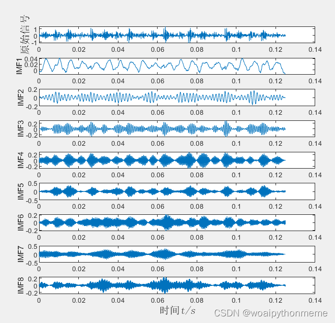
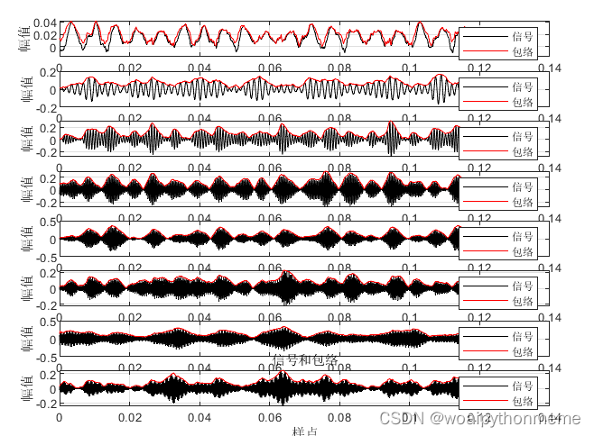
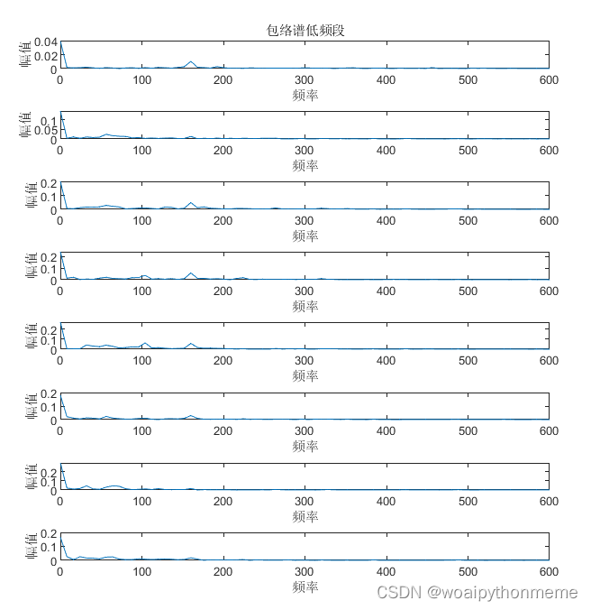
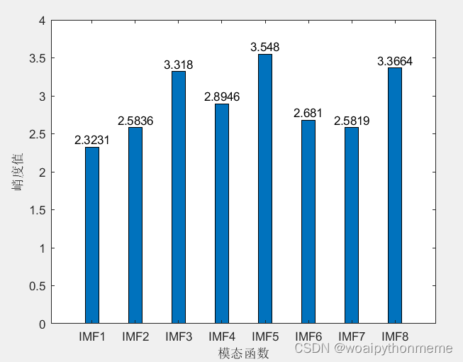
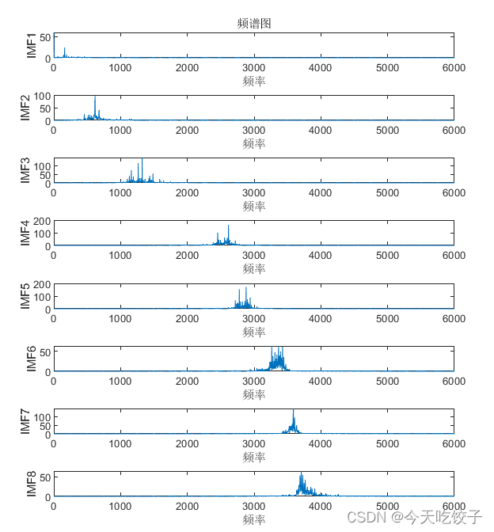
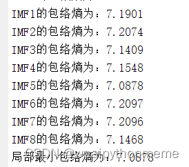
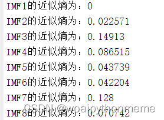
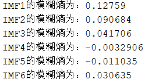
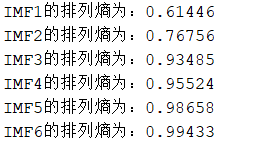
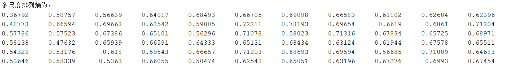
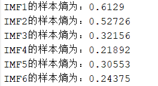

<!-- PAYMENT_BLOCK -->

## Get this dataset

- Payment link (Stripe): [Buy now](https://buy.stripe.com/3cs8yP7sY87d0vu9AB)
- Payment QR code: 

<!-- /PAYMENT_BLOCK -->
